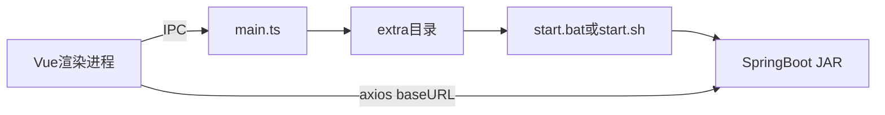

# SIM-TRADE-AUTO-CLIENT

Sim Trade 模拟外贸自动执行桌面客户端。Electron 壳负责窗口、配置和本地 Java 服务的启停，Vue 界面负责合同、流程、邮件、广告和贷款等业务操作。业务数据由随应用打包的 Spring Boot 服务提供，接口前缀为 `/sim-trade/**`。

本文面向交接：说明如何把工程跑起来、改代码时要注意什么、各功能落在哪些文件，以及如何打出安装包。

## 技术栈

| 部分 | 选型 |
| --- | --- |
| 桌面壳 | Electron 39、Electron Forge 7、Vite 5 |
| 界面 | Vue 3、Vue Router 4、Pinia、Ant Design Vue 4、Tailwind CSS 3、vue-i18n |
| 请求 | axios |
| 后端运行时 | 仓库自带 JRE 8（`extra/jre`，Windows 32 位 `1.8.0_281`） |
| 后端服务 | `extra/service/sim-trade-auto-sys-1.0-SNAPSHOT.jar` |

## 架构

主进程启动后读取 `extra` 下的配置。后台配置里 `autoStart` 为 true 时，用 `start.bat`（Windows）或 `start.sh`（其他系统）拉起 JAR，并把配置中的端口传给 `--server.port`。渲染进程通过 IPC 读写配置、启停服务；业务请求由 axios 发到 `baseUrl`。



开发环境里，编译产物在 `.vite/build`，代码用 `__dirname` 向上两级定位仓库根目录的 `extra`。打包后 `extra` 作为 `extraResource` 放到安装目录的 `resources/extra`（Windows 下与 exe 同级的 `resources`）。解析逻辑在 `src/main.ts`、`src/utils/background.ts` 以及两个配置管理类里，三处写法保持一致。

## 目录

| 路径 | 作用 |
| --- | --- |
| `src/main.ts` | 创建窗口、初始化配置、按配置启动 JAR、退出时请求 shutdown |
| `src/preload.ts` | 向渲染进程暴露 `window.electronAPI` |
| `src/ipc/handler.ts` | 配置读写、JAR 启停、VPN 登录窗 |
| `src/renderer.ts` | 挂载 Vue、Pinia、路由、Ant Design、i18n |
| `src/router/router.ts` | 路由表与认证守卫 |
| `src/views/**` | 页面。接口调用和页面状态写在同目录 `hook.ts` |
| `src/views/menu/setting.ts` | 左侧菜单 |
| `src/apis/**` | 后端 API 封装 |
| `src/locales/zh.ts`、`src/locales/en.ts` | 中英文文案 |
| `src/utils/request.ts` | axios 实例、统一响应解包、文件上传下载 |
| `extra/jre` | 自带 JRE，启动脚本固定使用它 |
| `extra/service` | JAR、`application.yml`、运行后生成的 `sim-trade.pid` |
| `extra/start.bat`、`extra/start.sh` | 启动 JAR |
| `extra/stop.bat`、`extra/stop.sh` | 按 PID 文件结束进程 |
| `extra/config/config.json` | 语言、字号、主题色、亮暗模式 |
| `extra/config/backgroundConfig.json` | 服务地址、端口、是否随应用自启动 |
| `extra/env.json` | 另一份地址和端口，见下方端口说明 |
| `forge.config.ts` | 打包配置，把整个 `extra` 打进安装包 |
| `assets/icon` | 应用图标 |

## 环境与本地搭建

需要 Node.js 20 及以上和 npm。后端不需要单独安装 JDK，启动脚本使用 `extra/jre/bin/java`。

```bash
npm install
npm start
```

`npm start` 即 `electron-forge start`。未打包时会自动打开 DevTools。

首次启动会读 `extra/config/backgroundConfig.json`。当前仓库里的内容是：

```json
{
  "baseUrl": "http://localhost:9090",
  "port": 9090,
  "autoStart": true
}
```

`autoStart` 为 true 时，主进程执行 `extra/start.bat 9090`（非 Windows 为 `start.sh`）。脚本进入 `extra/service`，用自带 JRE 运行：

```text
java -Djava.net.preferIPv4Stack=true -jar sim-trade-auto-sys-1.0-SNAPSHOT.jar --server.port=<端口>
```

渲染进程加载后台配置后，把 `baseUrl` 写到 `window.__API_BASE_URL__`。axios 优先用这个地址；尚未写入时兜底为 `http://localhost:9081`（`src/utils/request.ts`）。本地调试前先在「后台配置」里点一次状态检查，确认 `/sim-trade/status/healthy` 能通。

应用配置（语言、主题）在 `extra/config/config.json`。界面上的修改会写回这两个 JSON。

## 开发注意事项

### 端口要对齐

真正决定「JAR 监听哪个端口」和「前端请求打到哪里」的，是 `extra/config/backgroundConfig.json` 里的 `port` 和 `baseUrl`。改端口时这两项一起改，并且 `baseUrl` 里的端口与 `port` 相同。

仓库里还有几处写死或默认值不同，改端口时容易漏：

| 位置 | 当前值 | 实际作用 |
| --- | --- | --- |
| `extra/config/backgroundConfig.json` | `9090` | 启动 JAR 的端口，以及前端 `baseUrl` |
| `extra/service/application.yml` | `9090` | JAR 默认端口；命令行 `--server.port` 会覆盖它 |
| `extra/env.json` | `9081` | 主进程启动时会读取，启动 JAR 时用的是后台配置端口 |
| `src/utils/request.ts` 兜底地址 | `9081` | 后台配置还没加载到 `window` 时的请求地址 |
| `extra/shutdown.bat` | 写死 `9081` | 按端口查找并结束监听进程，与当前自启动端口不一致 |
| `BackgroundManager` 代码默认值 | `9090` | 配置文件缺失时的默认值 |

界面「后台配置」保存的就是 `backgroundConfig.json`。保存后再启动或重启服务，新端口才会作用到 JAR。

### 服务启停

- 启动：`src/utils/background.ts` 的 `runNetdiskJar`，Windows 走 `start.bat`，其他系统走 `start.sh`。
- 界面停止：IPC `stop-jar` 调用 `stop.bat` / `stop.sh`，读取 `extra/service/sim-trade.pid`。`stop.bat` 末尾有 `pause`，从界面停服务时命令窗口可能停住，需要在该窗口按键才会结束。
- 退出应用：`autoStart` 为 true 时，`before-quit` 会请求 `{baseUrl}/sim-trade/shutdown`。请求失败只打日志，应用仍会退出。
- 健康检查：`GET /sim-trade/status/healthy`。

### 运行平台

自带 JRE 是 Windows 32 位（`extra/jre/release` 中 `OS_ARCH=i586`）。`start.sh` 同样查找 `extra/jre/bin/java`，当前 `extra/jre` 里是 `java.exe`。在 Linux 或 macOS 上跑通本地服务，需要自行准备对应平台的 JRE，并放到脚本期望的路径。

打包配置里的 Maker 还包含 rpm、deb 和 zip，Windows 日常交付以 Squirrel 安装包为准。

### 配置与日志的落盘位置

- 开发时，配置和日志都在仓库的 `extra` 下：`extra/config/*.json`、`extra/main.log`（主进程，`electron-log`，单文件上限 10MB）。
- 打包后，同一套文件在安装目录的 `resources/extra`。`extraResource` 在 asar 之外，配置可以改写。
- 更换后端：替换 `extra/service/sim-trade-auto-sys-1.0-SNAPSHOT.jar` 后重新打包。启动脚本里的 JAR 文件名是写死的，换名需要同时改 `start.bat` 和 `start.sh`。

### 认证

路由使用 `createMemoryHistory`，认证状态在 Pinia 内存中。关闭应用后需要重新认证。

守卫在 `src/router/router.ts`：除 `/auth` 外，未登录或 token 过期会跳到认证页。距上次认证超过 3 小时，会再请求 token 接口核对。

token 列表来自外部 mock，不走本地 JAR，地址在 `src/apis/token.ts` 的 `ADMIN_TOKEN_URL`、`TEMP_TOKEN_URL`。内置管理员口令是 `src/views/auth/hook.ts` 里的 `AUTO_ADMIN_TOKEN`。该口令在本地直接通过，后端不可达时也会按管理员身份放行。管理员 token 的过期时间被写成 `2099-12-31`；临时 token 使用接口返回的 `expirationTime`。

### 新增页面的约定

1. 在 `src/router/router.ts` 增加路由。需要缓存的页面把 `meta.keepAlive` 设为 `true`。
2. 在 `src/views/menu/setting.ts` 增加侧栏项。
3. 文案同时写入 `src/locales/zh.ts` 和 `src/locales/en.ts`，页面用 `useI18n` 的 `t()`。
4. HTTP 封装放在 `src/apis`，页面状态和请求写在对应目录的 `hook.ts`，页面组件只负责展示和事件。
5. 主题色、亮暗模式由 `App.vue` 注入 CSS 变量。新页面沿用已有的 `--app-*` 变量，避免写死背景色。

`hook.ts` 的写法与现有页面一致：内部维护 `loading` 和数据 `ref`，请求放在异步函数里，最后把方法和状态一并返回。

### 工作台轮询

合同状态为 `DOING` 时，工作台每 5 秒调用最新日志和整页刷新。其他状态只拉一次。离开页面或状态离开 `DOING` 时会清掉定时器。改这块逻辑时保留清理，避免切页后继续请求。

### 菜单

`src/main.ts` 在创建窗口后执行 `Menu.setApplicationMenu(null)`，系统菜单栏是隐藏的。用户入口是左侧栏。`src/menu/menu.ts` 里的原生菜单目前不会在启动时显示。

## 功能模块

侧栏定义在 `src/views/menu/setting.ts`。各模块的页面设计原稿在对应目录的 `design.txt`（若有）。

### 首页 `/`

`src/views/Home.vue`。展示 Sim Trade 平台说明和本客户端能力介绍，链到外部实训平台。无业务接口。

### 工作台 `/desk`

`src/views/desk/index.vue`、`hook.ts`。看当前正在执行的合同，并控制执行。

- 合同摘要：外销合同号、工厂合同号、数量、商品、报价、国家与港口。`GET /sim-trade/contract-info/getCurrentInfo`
- 执行状态：`TODO`、`DOING`、`DONE`、`STOPPED`、`FAIL`。`TODO` 显示执行，`STOPPED` / `FAIL` 显示继续，`DOING` 显示停止，`DONE` 禁用按钮
- 执行：`POST /sim-trade/contract-info/executeContract`
- 停止：`POST /sim-trade/contract-info/stopContract`
- 单步：`POST /sim-trade/contract-info/executeStep`
- 左侧时间轴：流程步骤、已完成步骤、未完成步骤（`fulfillment-process-step` 的 `listByProcessCode`、`getDoneProcessSteps`、`getUndoProcessSteps`）
- 右侧日志：`GET /sim-trade/contract-task-history/getLatestHistory`，`DOING` 时每 5 秒轮询
- 未执行步骤列表，以及批量执行

### 合同管理 `/contract`

`src/views/contract/index.vue`、`hook.ts`。维护一份可执行合同的账号、港口和交易条件，保存后执行。

表单分三块：

- 账号：出口商、进口商、供应商、出口地银行、进口地银行的账号密码
- 通用：出口港、进口国、进口港的中英文
- 合同：外销合同号、工厂合同号、商品编号、数量、出口报价及单位、市场报价、汇率、工厂报价（人民币）

保存走业务配置接口（`/sim-trade/businessConfig`）。执行与工作台相同，调用 `executeContract`。汇率可通过 `POST /sim-trade/businessConfig/getCrawlRate` 抓取。

可选 VPN：填写地址后，主进程打开独立登录窗口（IPC `open-vpn-auth-window`），登录成功后收集 Cookie，随执行请求的 `vpnCookies` 提交。VPN 地址和 Cookie 存在渲染进程的 `localStorage`（键名 `contract-vpn-settings`）。

### 公司管理 `/company`

`src/views/company/index.vue`、`hook.ts`。五个页签维护主体资料：

| companyCode | 页签 |
| --- | --- |
| `EXPORTER_COMPANY` | 出口商 |
| `IMPORTER_COMPANY` | 进口商 |
| `SUPPLIER_COMPANY` | 供应商（工厂） |
| `NEGOTIATING_BANK_COMPANY` | 出口地银行 |
| `ISSUING_BANK_COMPANY` | 进口地银行 |

读取 `GET /sim-trade/sys-profile-parameter/getCompany/{companyCode}`，保存 `PUT /sim-trade/sys-profile-parameter/updateCompany/{companyCode}`。进口商和进口地银行以英文字段为主，其余主体含中英文字段。支持按公司导入、导出：`/sim-trade/company/import/{companyCode}`、`/sim-trade/company/export/{companyCode}`。

### 流程管理 `/process`

`src/views/process/index.vue`、`UpdateModal.vue`、`hook.ts`。按贸易术语和结算方式维护履约步骤。

- 贸易术语：`CIF`、`CFR`、`FOB`
- 结算方式：`L/C`、`D/P`、`D/A`、`T/T`
- 列表：`POST /sim-trade/fulfillment-process-step/list`，可传 `trade`、`payment`、`search`
- 列：步骤名称、步骤编码、归属角色、延迟秒数、重新执行是否跳过
- 角色编码：`EXPORTER`、`IMPORTER`、`SUPPLIER`、`ISSUING_BANK`、`NEGOTIATING_BANK`
- 修改：单条 `PUT /sim-trade/fulfillment-process-step/{id}`，批量 `batchUpdate`
- 排序：`moveUp`、`moveDown`
- 导入导出：`/sim-trade/fulfillment-process-step/import`、`export`

### 邮箱管理 `/email`

`src/views/email/index.vue`，业务邮件在 `BusinessEmail.vue`，通用邮件在 `NormalEmail.vue`，逻辑在 `hook.ts`。

业务邮件是 8 类模板，每类有主题和正文。进入页面调用 `GET /sim-trade/email/getEmailContent` 回填，保存调用 `POST /sim-trade/email/saveEmailContent`，发送调用 `POST /sim-trade/email/sendEmail/{sendType}`。

| sendType | 含义 |
| --- | --- |
| `EXPORTER_TO_IMPORTER_FIRST` | 出口商发给进口商，第一次 |
| `IMPORTER_TO_EXPORTER_FIRST` | 进口商回复出口商，第一次 |
| `EXPORTER_TO_IMPORTER_SECOND` | 出口商发给进口商，第二次 |
| `IMPORTER_TO_EXPORTER_SECOND` | 进口商回复出口商，第二次 |
| `EXPORTER_TO_SUPPLIER_FIRST` | 出口商发给工厂，第一次 |
| `SUPPLIER_TO_EXPORTER_FIRST` | 工厂回复出口商，第一次 |
| `EXPORTER_TO_SUPPLIER_SECOND` | 出口商回复工厂，第二次 |
| `SUPPLIER_TO_EXPORTER_SECOND` | 工厂回复出口商，第二次 |

通用邮件表单包含发件账号、密码、角色、收件邮箱和正文，发送接口为 `POST /sim-trade/email/sendNormalEmail`。另有按角色读取邮件：`POST /sim-trade/email/readEmails`。

### 广告管理 `/advertisement`

`PublishAds.vue` 发布广告，`PublishInfo.vue` 发布信息，逻辑在 `hook.ts`。

- 发布广告 `POST /sim-trade/advertisement/publishAds`：账号、密码、角色、标题、关键字、发布类型（`COMPANY` 公司 / `GOODS` 产品）、内容。类型为产品时才填写产品编号。
- 发布信息 `POST /sim-trade/advertisement/publishInfo`：发布类型为 `SUPPLY`、`DEMAND`、`OTHER`。

角色取值与流程管理相同。该路由 `keepAlive` 为 true。

### 贷款管理 `/loan`

`src/views/loan/index.vue`、`hook.ts`。出口商、进口商、供应商向银行申请贷款。

字段：银行编号 `bankCode`、金额 `money`、币种 `moneyType`（EUR、GBP、HKD、JPY、RMB、SEK、SGD、USD）、说明 `message`、角色 `role`（`EXPORTER` / `IMPORTER` / `SUPPLIER`）。提交 `POST /sim-trade/loan/apply`。该路由 `keepAlive` 为 true。

### 历史合同 `/history`

`src/views/history/index.vue`、`hook.ts`。分页查询合同记录，支持关键字搜索。接口 `POST /sim-trade/contract-info/list`，参数含 `current`、`size`、`search`。

### 系统配置

- 应用设置 `/normalConfig`：`src/views/settings/NormalConfig.vue`。语言（zh / en）、字号、主题色、亮暗模式，写入 `extra/config/config.json`。`keepAlive` 为 true。
- 后台配置 `/backgroundConfig`：`src/views/settings/BackgroudConfig.vue`（文件名拼写即为此）。编辑 `baseUrl`、`port`、`autoStart`，检查健康状态，并对本机服务执行启动或停止。`keepAlive` 为 true。
- 身份认证 `/auth`：`src/views/auth/index.vue`。输入 token，对照管理员列表、内置管理员口令和临时 token。

## 编译与打包

```bash
npm run lint      # eslint，检查 .ts / .tsx
npm run package   # 生成未安装的应用目录
npm run make      # 生成安装包
```

`npm run make` 在 Windows 上会生成：

- Squirrel 安装程序，产物名 `SimTradeAuto-Setup.exe`（maker 名称 `SimTradeAuto`）
- zip 压缩包

安装默认到当前用户目录，不要求管理员权限。产品显示名在 `forge.config.ts` 的 `packagerConfig.name`，为 `SimTradeAuto`。图标使用 `assets/icon`。

本机能执行 `light.exe`（已安装 WiX Toolset）时，还会多打一个 MSI，安装模式为 per-user，安装向导可以选择目录。未检测到 WiX 时跳过 MSI，控制台会打印安装提示（Chocolatey：`choco install wix`，或 winget：`winget install WiXToolset.WiXToolset`）。

打包时整个 `extra`（含 JRE 和 JAR）复制到 `resources/extra`。应用启用 asar，并且只从 asar 加载应用代码；`extra` 在 asar 外，运行时由主进程按 `process.resourcesPath` 查找。

`npm run publish` 在 `package.json` 里有脚本，`forge.config.ts` 的 `publishers` 目前为空，执行不会发布到远端。

## 交接核对

接手后建议先确认这几项，再开始改功能：

1. `extra/config/backgroundConfig.json` 的 `baseUrl` 与 `port` 一致，且与本机实际监听端口一致。
2. `extra/service/sim-trade-auto-sys-1.0-SNAPSHOT.jar` 是当前要交付的后端版本。
3. `extra/jre/bin/java.exe` 存在，`npm start` 后健康检查为运行中。
4. `src/apis/token.ts` 里的 mock 地址仍可访问；不可访问时，使用内置管理员口令仍可进入界面，但在线校验会失败。
5. 改完界面后执行 `npm run lint`；交付安装包前执行 `npm run make`，并在安装后的 `resources/extra` 中确认 JAR 与配置被打进去。
